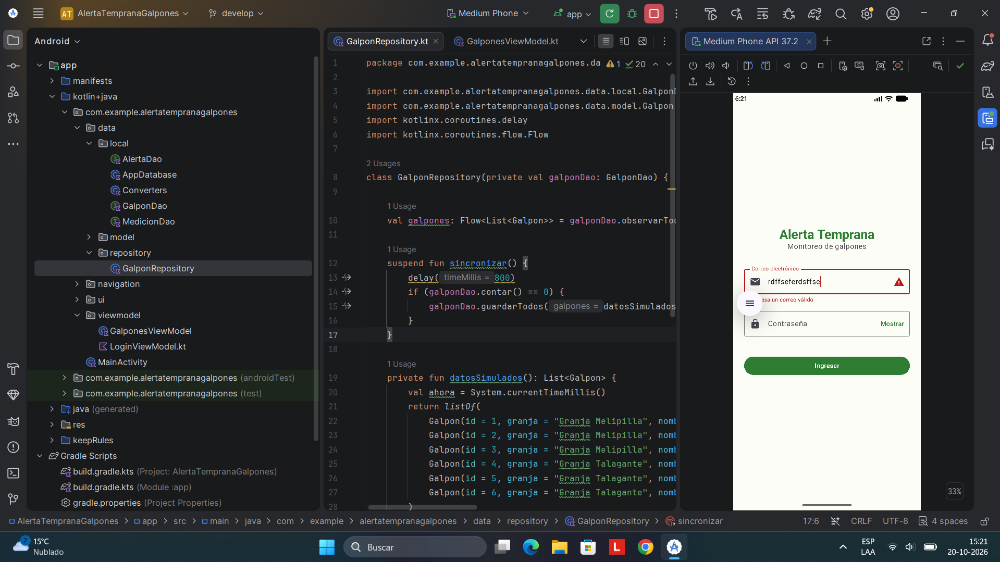
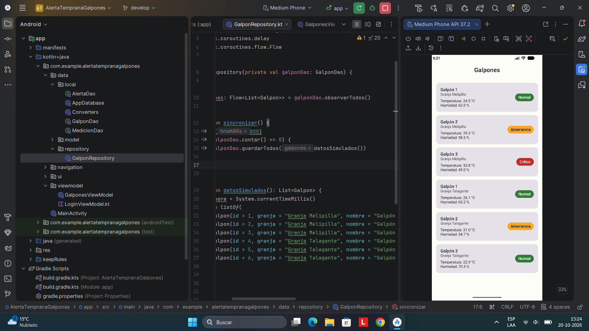
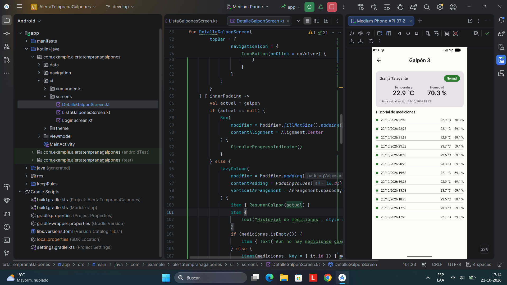
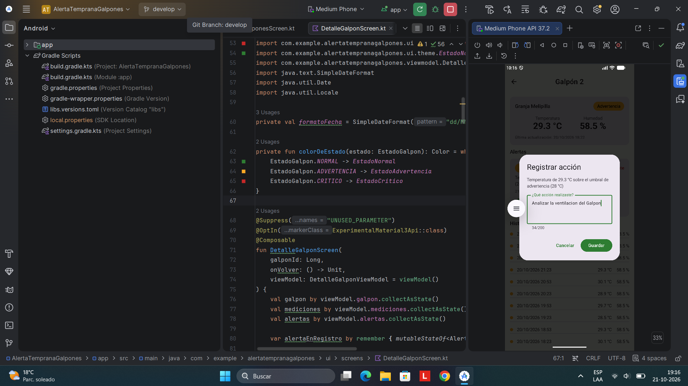
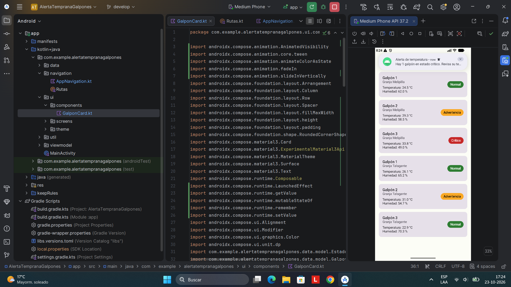

# Alerta Temprana de Galpones

Aplicación móvil Android para el monitoreo de temperatura y humedad en galpones avícolas, con alertas tempranas ante altas temperaturas.

**Asignatura:** Desarrollo de Aplicaciones Móviles · Duoc UC
**Evaluación:** Parcial 2 – Encargo Caso: Alerta temprana por altas temperaturas
**Autor:** Felipe Garrido · 001-D
**Docente:** Fernando Sepúlveda

\---

## Descripción del caso

Una empresa avícola necesita saber a tiempo cuándo la temperatura de sus galpones sube a niveles peligrosos para las aves. La app permite a los operarios revisar el estado de cada galpón, recibir un aviso cuando hay uno en estado crítico y registrar la acción que realizaron para atender cada alerta.

Los datos de sensores son **simulados** (ficticios), como permite el caso. La app los guarda en una base de datos local, por lo que sigue funcionando **sin conexión a internet**.

## Funcionalidades

* **Inicio de sesión** con formulario validado (correo con formato válido y contraseña de mínimo 6 caracteres), mensajes de error en cada campo y opción de mostrar u ocultar la contraseña.
* **Lista de galpones** de dos granjas, con temperatura, humedad y estado: **Normal**, **Advertencia** o **Crítico** (por colores).
* **Detalle del galpón**: valores actuales, última actualización, alertas e **historial de mediciones**.
* **Registro de acciones realizadas** sobre cada alerta, con formulario validado (5 a 200 caracteres). La alerta pasa a «Atendida» y la acción queda guardada.
* **Notificación y vibración** cuando hay galpones en estado crítico.
* **Animaciones** de entrada de tarjetas, cambio de color del estado y transiciones entre pantallas.

### Umbrales de estado (simulados)

|Estado|Temperatura|
|-|-|
|Normal|menos de 28 °C|
|Advertencia|28 °C o más, menos de 32 °C|
|Crítico|32 °C o más|

## Requisitos de la evaluación

|Requisito|Cómo se cumple|
|-|-|
|Diseño Material 3|Tema, colores y tipografía Material 3; componentes `Card`, `Scaffold`, `AlertDialog`, `OutlinedTextField`.|
|Formularios validados|Login y registro de acción, con validación en el ViewModel y mensajes de error.|
|Navegación|Navigation Compose: login → lista → detalle, con argumento de galpón.|
|Gestión de estado|MVVM con `ViewModel`, `StateFlow` y `collectAsState`.|
|Almacenamiento local|Room (galpones, mediciones y alertas).|
|Recursos nativos (mín. 2)|**Notificaciones** (con permiso en Android 13+) y **vibración**.|
|Animaciones|`AnimatedVisibility`, `animateColorAsState` y transiciones de navegación.|
|Trabajo colaborativo|Trello y GitHub (ramas, commits descriptivos y Pull Requests).|

## Arquitectura (MVVM)

```
app/src/main/java/com/example/alertatempranagalpones/
├── data/
│   ├── local/        AppDatabase, GalponDao, MedicionDao, AlertaDao, Converters
│   ├── model/        Galpon, Medicion, Alerta, EstadoGalpon
│   └── repository/   GalponRepository
├── navigation/       Rutas, AppNavigation
├── ui/
│   ├── components/   GalponCard
│   ├── screens/      LoginScreen, ListaGalponesScreen, DetalleGalponScreen
│   └── theme/        Color, Type, Theme
├── util/             Notificador (notificaciones y vibración)
├── viewmodel/        LoginViewModel, GalponesViewModel, DetalleGalponViewModel
└── MainActivity.kt
```

* **Model:** entidades de Room y reglas de estado.
* **View:** pantallas en Jetpack Compose, que solo observan el estado.
* **ViewModel:** valida formularios y expone el estado a las pantallas.
* **Repository:** única fuente de datos; la pantalla siempre lee desde Room y los datos simulados se cargan la primera vez.

## Tecnologías

Kotlin · Jetpack Compose · Material 3 · Navigation Compose · Room + KSP · Coroutines y Flow · Gradle (Version Catalog)

## Cómo ejecutar

1. Clonar el repositorio: `git clone https://github.com/FelipeG17-svg/AlertaTempranaGalpones.git `
2. Abrir la carpeta en **Android Studio**.
3. Esperar a que termine la sincronización de Gradle.
4. Ejecutar la app (▶) en un emulador o en un celular Android.

Para probar: ingresar con un correo válido (por ejemplo `prueba@duocuc.cl`) y una contraseña de 6 o más caracteres. Al llegar a la lista, aceptar el permiso de notificaciones.

## Capturas de pantalla

|Login con validación|Lista de galpones|
|-|-|
|||

|Detalle del galpón|Registro de acción|
|-|-|
|||

|Notificación de alerta crítica|
|-|
||

## Gestión del proyecto

* **Trello:** https://trello.com/b/T6NgF98f/alerta-temprana-galpones
* **Ramas:** `main` (versión estable) y `develop` (trabajo diario), integradas mediante Pull Requests.
* **Commits:** mensajes descriptivos con prefijos.

## Limitaciones y trabajo futuro

* Los datos de temperatura y humedad son simulados; falta conectar sensores o una API real.
* El inicio de sesión valida el formato de los datos, pero no hay autenticación contra un servidor.
* La vibración no es visible en el emulador; requiere un celular físico.

